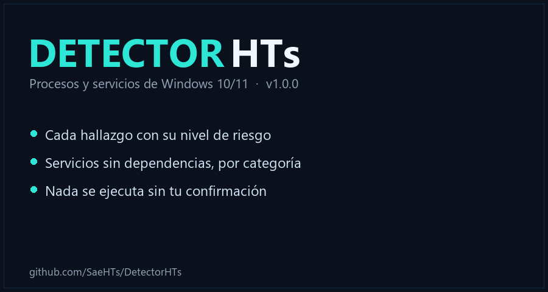

<p align="center">
  
</p>

# DetectorHTs

Herramienta para Windows 10/11 que detecta procesos y servicios innecesarios y
permite actuar sobre ellos **con confirmación explícita**. Incluye interfaz
gráfica (Tkinter, tema cyberdark) y modo consola.

## Descarga

Descarga desde [Releases](https://github.com/SaeHTs/DetectorHTs/releases/latest):

- **DetectorHTs.exe** - Ejecutable portable (recomendado). Se ejecuta sin instalar.
- **DetectorHTs.zip** - El mismo ejecutable comprimido.

Requiere Windows 10/11 (x64) y permisos de administrador para revisar servicios.

## Qué detecta

- **Procesos con alto consumo**: CPU y RAM por encima de los umbrales definidos.
- **Procesos inactivos**: sin actividad de CPU en las últimas 24 horas.
- **Servicios sin dependencias**: servicios que ningún otro servicio necesita.

Cada hallazgo se clasifica por nivel de riesgo y los servicios se agrupan por
categoría (Microsoft, Windows Update, Dispositivos, Red, Terceros, Otros).

## Capturas

<p align="center">
  
</p>

## Requisitos

- Windows 10/11 (x64)
- Python 3.10 o superior
- `psutil` (ver `requirements.txt`)

## Uso

```powershell
pip install -r requirements.txt

python gui.py     # interfaz gráfica
python main.py    # modo consola
```

## Compilar el ejecutable

Doble clic en `COMPILAR.bat`: crea el entorno virtual, instala las dependencias
y genera `dist\DetectorHTs.exe`.

## Pruebas

```powershell
pip install pytest
python -m pytest -q
```

## Idiomas

La interfaz está en español e inglés, con detección automática del idioma de
Windows y selector ES | EN en vivo.

## Seguridad

Ninguna acción se ejecuta sin confirmación del usuario. El escaneo es de solo
lectura hasta que se aprueba una acción concreta sobre un hallazgo.

## Licencia

MIT - ver [LICENSE](LICENSE).
